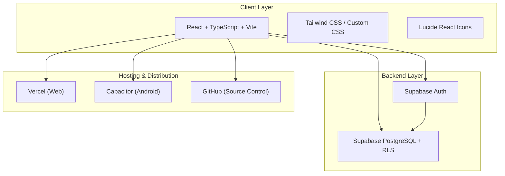
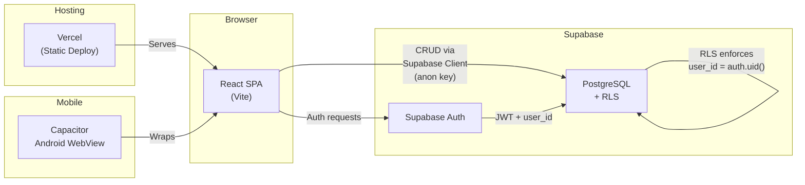
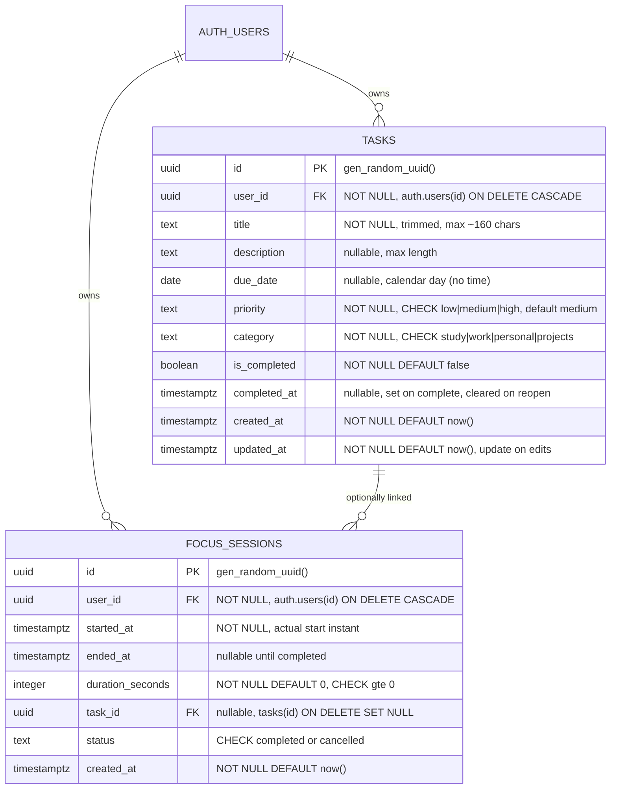
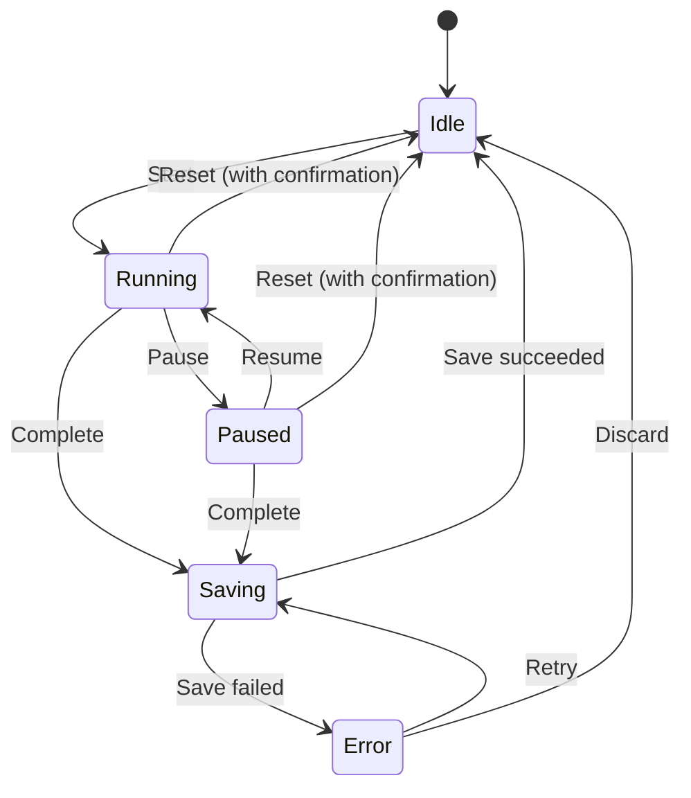
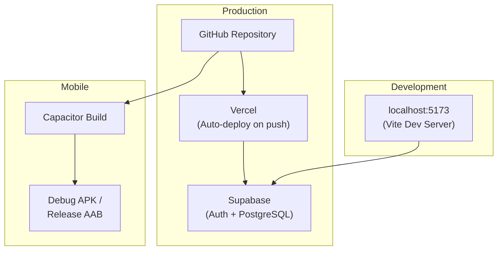

# Kachuno — Architecture Document

> **Version 1.0 · 21 October 2026**
> Distilled from *Kachuno 7-Day Project Blueprint v1.0*

---

## Table of Contents

1. [Product Vision & Principles](#1-product-vision--principles)
2. [Feature Scope (Version 1)](#2-feature-scope-version-1)
3. [Technology Stack](#3-technology-stack)
4. [System Architecture](#4-system-architecture)
5. [Project Structure](#5-project-structure)
6. [Data Model & Database Design](#6-data-model--database-design)
7. [Security Architecture](#7-security-architecture)
8. [Behavior Definitions & Calculation Rules](#8-behavior-definitions--calculation-rules)
9. [Engineering Rules & Conventions](#9-engineering-rules--conventions)
10. [Environment & Configuration](#10-environment--configuration)
11. [7-Day Build Plan Overview](#11-7-day-build-plan-overview)
12. [Deployment Architecture](#12-deployment-architecture)
13. [Risks & Decisions to Resolve](#13-risks--decisions-to-resolve)
14. [Acceptance Criteria](#14-acceptance-criteria)

---

## 1. Product Vision & Principles

### Vision

Kachuno helps people make steady progress through manageable daily actions. Its turtle-inspired identity communicates **patience, reliability, and calm focus** — not childishness or pressure. The product tells the truth about progress and makes the next useful action easy to see.

### Tagline

> *Small steps. Steady progress.*

### Core Principles

| Principle | Description |
|---|---|
| **Honest by default** | Every statistic has a defined formula and time period. No fabricated streaks, fake progress, or guilt-based copy. |
| **Low friction** | Common task actions are obvious and quick. Primary navigation is consistent across screen sizes. |
| **Private by design** | Each signed-in user accesses only their own records, enforced by PostgreSQL RLS — not merely hidden in the UI. |
| **Accessible** | Semantic HTML, visible keyboard focus, readable contrast, labelled controls, understandable errors. |
| **Resilient** | Handle loading, empty, offline/network failure, invalid input, expired sessions, and database errors. |
| **Small dependencies** | Avoid adding libraries unless they solve a clear problem. |

---

## 2. Feature Scope (Version 1)

### Included

| Area | Features | Definition of Done |
|---|---|---|
| **My Day** | Due-today tasks, overdue tasks, completion counts, focus time for today | Counts and lists derive from saved records; no hard-coded demo metrics |
| **Tasks** | Create, edit, complete, reopen, delete; description; due date; priority; category; filters | All CRUD operations work, validate input, and persist |
| **Calendar** | Monthly and weekly views, tasks on due dates, date selection | Date placement is correct across month boundaries and local timezone |
| **Focus** | Start, pause, resume, reset; optionally link task; save completed sessions | Elapsed time is not lost when a tab redraws; completed session duration is accurate |
| **Progress** | History, completion rate, overdue count, focus minutes, weekly trends | Formulas and periods are explicit; zero-data periods are handled safely |
| **Authentication** | Sign up, sign in, sign out | User can recover from errors and session state is handled |
| **Cloud Data** | Supabase PostgreSQL persistence and RLS | Data survives reload; two-account isolation tests pass |
| **Responsive UX** | Phone, tablet, desktop; calm visual identity; loading/error/empty states | No major layout breakage at representative viewport sizes |
| **Delivery** | GitHub, Vercel web deployment, Capacitor Android debug/release build | Actual status and blockers are documented; no unverified claims |

### Explicit Exclusions

- AI planning, recurring tasks, push notifications, external calendar sync
- Collaboration, social features, payments/subscriptions, paid APIs
- Extensive theme/customization settings
- Features offered by libraries/templates that fall outside V1 scope (record as future ideas only)

---

## 3. Technology Stack



| Layer | Choice | Guidance |
|---|---|---|
| **UI** | React + TypeScript + Vite | Reusable components, typed models, small feature-focused modules |
| **Styling** | Tailwind CSS or Custom CSS | Choose one; keep spacing, colors, typography, and states consistent |
| **Icons** | Lucide React | Accessible labels; never icon-only where meaning may be unclear |
| **Auth / Data** | Supabase Auth + PostgreSQL | Official Supabase client; env vars for URL and anon key |
| **Security** | RLS Policies | Enable on every user-owned table; `auth.uid()` ownership checks |
| **Version Control** | Git + GitHub | Small, reviewable commits; never push without user approval |
| **Web Hosting** | Vercel (free tier) | Env vars in project settings; verify deployed behavior |
| **Android** | Capacitor | May require Android Studio, SDK, JDK. Report environment blockers accurately |

---

## 4. System Architecture



### Data Flow

1. **User** interacts with the React UI (web or Capacitor-wrapped Android).
2. **Supabase Auth** handles sign-up/sign-in and provides a JWT containing `auth.uid()`.
3. **Supabase Client** (using the anon/publishable key) sends CRUD requests to PostgreSQL.
4. **Row Level Security (RLS)** on every user-owned table ensures `user_id = auth.uid()` — the true security boundary.
5. **Vercel** serves the production static build. Environment holds only public Supabase URL + anon key.

---

## 5. Project Structure

```
src/
  app/                     # App shell, routing, providers
  components/              # Shared buttons, inputs, modals, state components
  features/
    auth/                  # Sign-up, sign-in, session handling
    tasks/                 # Task forms, list, filters, data access
    calendar/              # Month/week view and selected date
    focus/                 # Timer state and session saving
    progress/              # Calculations, history, trends
  lib/
    supabase.ts            # Configured Supabase client
    dates.ts               # Shared local-date helpers
    validation.ts          # Reusable validation rules
  styles/                  # Design tokens and global styles
  types/                   # Shared database/domain types

docs/
  DAILY_LOG.md
  ARCHITECTURE.md
  TEST_PLAN.md

.env.example               # Placeholders only; no real secrets
.gitignore
README.md
capacitor.config.ts         # Added Day 6
android/                    # Generated by Capacitor
```

> **Note:** This is a target structure, not a mandate to reorganize a repository that already has a sound structure. Existing conventions should be preserved where practical.

---

## 6. Data Model & Database Design

### Entity-Relationship Diagram



### Key Design Decisions

| Decision | Rationale |
|---|---|
| `due_date` is `date` (not `timestamptz`) | Represents a calendar day without time; avoids timezone-shift bugs |
| `completed_at` is `timestamptz` | Records the exact instant of completion |
| `task_id ON DELETE SET NULL` on focus sessions | Deleting a task preserves focus history; link is cleared, not cascaded |
| `duration_seconds` as `integer` with `CHECK >= 0` | UI displays rounded minutes; exact seconds stored for accuracy |
| Priority/category as `text` with `CHECK` constraints | Enforced at DB level; validated in UI as well |

### Recommended Indexes

| Index | Purpose |
|---|---|
| `tasks(user_id, due_date)` | My Day / Calendar queries |
| `tasks(user_id, is_completed)` | Filter by completion status |
| `focus_sessions(user_id, started_at)` | Focus history / progress queries |

### Data Integrity Rules

- On task completion: set `is_completed = true`, `completed_at = now()`
- On task reopen: set `is_completed = false`, clear `completed_at`
- Use migrations or saved SQL scripts so schema changes are repeatable and reviewable
- Consider a DB constraint or trigger to validate that a linked `task_id` belongs to the same `user_id`

---

## 7. Security Architecture

### RLS Policy Design

```sql
-- Tasks
ALTER TABLE public.tasks ENABLE ROW LEVEL SECURITY;
CREATE POLICY "Users manage own tasks" ON public.tasks
  FOR ALL TO authenticated
  USING (auth.uid() = user_id)
  WITH CHECK (auth.uid() = user_id);

-- Focus Sessions
ALTER TABLE public.focus_sessions ENABLE ROW LEVEL SECURITY;
CREATE POLICY "Users manage own focus sessions" ON public.focus_sessions
  FOR ALL TO authenticated
  USING (auth.uid() = user_id)
  WITH CHECK (auth.uid() = user_id);
```

> These are illustrative policy shapes. Inspect actual schema names and test policy behavior before applying.

### Two-Account Isolation Test Protocol

1. Create test accounts **A** and **B**
2. Sign in as A → create ≥ 2 tasks + 1 focus session
3. Sign out → sign in as B → confirm B sees **none** of A's records
4. As B, attempt direct client queries for A's known IDs → reads return no data
5. As B, attempt update/delete on A's IDs → must be rejected
6. As B, attempt insert with `user_id` set to A → database must reject
7. Sign back in as A → verify records intact

### Secret Management Rules

| ✅ Allowed | ❌ Never Allowed |
|---|---|
| `VITE_SUPABASE_URL` (public) | Service-role / secret key in frontend code |
| `VITE_SUPABASE_ANON_KEY` (publishable) | `.env` or `.env.local` in Git |
| `.env.example` with placeholders | Real keys in screenshots, logs, or issues |
| Production vars in Vercel settings | Signing keystores or passwords in repo |

---

## 8. Behavior Definitions & Calculation Rules

### Task State Logic

| Concept | Definition |
|---|---|
| **Overdue** | Incomplete + `due_date` < today's local date. Completed past-due tasks are NOT counted as currently overdue |
| **Due today** | `due_date` = today's local date (complete or incomplete) |
| **No due date** | Visible in Tasks view; NOT placed on a calendar day |
| **Filter semantics** | AND-based: category + priority + status must all match |
| **Delete behavior** | Requires intentional action + confirmation. If a focus session is linked, retain session history and clear `task_id` |

### Focus Timer State Machine



| Rule | Detail |
|---|---|
| **Elapsed time source** | Timestamps + accumulated paused duration — NOT UI interval ticks |
| **Save condition** | Only on explicit user completion. Minimum 1 second; reject 0/negative |
| **Duplicate prevention** | Disable completion button while saving; guard against repeat invocation |
| **Tab/background** | Elapsed time must survive background tabs and device sleep |

### Progress Calculations

| Metric | Formula |
|---|---|
| **Completion rate** | `(completed tasks in period / tasks created in period) × 100`. Zero denominator → *"No tasks in this period"* (not 0% or 100%) |
| **Overdue count** | Count of incomplete tasks with `due_date < today` (current snapshot on My Day) |
| **Focus minutes** | `SUM(duration_seconds)` of completed sessions where `ended_at` falls inside selected period, `/ 60`. Display rounded minutes |
| **Weekly trend** | Consistent 7-day or calendar-week range. Include zero-activity days as zero — never omit or fabricate |
| **No-data period** | Show neutral empty state: *"No qualifying activity exists"*. Never invent chart values |

> **Period boundaries** must be explicit in the UI (e.g., "This week: Mon–Sun" or "Last 7 days") and consistent across labels, calculations, and tests.

---

## 9. Engineering Rules & Conventions

### TypeScript

- Use typed models for `Task` and `FocusSession`
- Avoid `any` unless temporary and documented
- Use stable IDs (not array positions) as React keys

### Data Access

- Keep DB operations in small service/helper modules
- Do not scatter query logic through components
- Represent loading, success, empty, and error states explicitly

### Date Handling

- **Single documented convention**: `due_date` → `date` (calendar day), session instants → `timestamptz`
- Use local calendar dates for "today" and selected calendar days
- Never compare date-only strings to UTC timestamps without conversion

### Error Handling

- Do not silently swallow failed writes
- Tell the user what failed and allow retry where practical
- Validate in UI **and** enforce at DB level (constraints, RLS)

### Design Tokens (Visual Identity)

| Token | Value |
|---|---|
| Primary | Deep forest green |
| Secondary | Muted sage |
| Background | Warm neutral |
| Text | Readable contrast (meets WCAG) |
| Borders | Defined border color |
| Spacing | Consistent scale |
| Focus ring | Visible keyboard focus indicator |
| Motif | Turtle — subtle shell geometry or restrained emblem (not cartoon) |

---

## 10. Environment & Configuration

### Development

```bash
# .env.example (commit this — placeholders only)
VITE_SUPABASE_URL=https://your-project.supabase.co
VITE_SUPABASE_ANON_KEY=your-anon-key-here
```

### .gitignore Must Include

```
.env
.env.local
.env.*
!.env.example
node_modules/
dist/
android/app/build/
*.keystore
*.jks
local.properties
```

### Production (Vercel)

- Set `VITE_SUPABASE_URL` and `VITE_SUPABASE_ANON_KEY` in Vercel project settings
- **Never** add a service-role key
- Configure Supabase Auth redirect URLs for both `localhost` and deployed domain
- Redeploy after changing variables

---

## 11. 7-Day Build Plan Overview

```mermaid
gantt
    title Kachuno 7-Day Build Plan
    dateFormat  X
    axisFormat Day %s

    section Foundation
    Day 1 - App Shell and UI         :d1, 1, 1d

    section Core Features
    Day 2 - Task Management        :d2, after d1, 1d
    Day 3 - Calendar and Focus Timer :d3, after d2, 1d

    section Backend
    Day 4 - Supabase and Auth        :d4, after d3, 1d

    section Analytics
    Day 5 - Progress and History     :d5, after d4, 1d

    section Polish and Ship
    Day 6 - Responsive and Android   :d6, after d5, 1d
    Day 7 - Deploy and Final QA      :d7, after d6, 1d
```



| Day | Focus | Key Outputs |
|---|---|---|
| **1** | Foundation & UI | App shell, navigation, 5 placeholder screens, design tokens, README, docs |
| **2** | Task Management | Full CRUD, filters, My Day derived from real data, form validation |
| **3** | Calendar & Focus Timer | Month/week views, timestamp-based timer, session save path |
| **4** | Supabase & Auth | Auth flows, migrations, RLS policies, replace temp storage, 2-account isolation test |
| **5** | Progress & History | Task/focus history, completion rate, weekly trends, edge case handling |
| **6** | Responsive Polish & Android | Accessibility audit, Capacitor config, debug APK attempt |
| **7** | Deployment & Final QA | Vercel deploy, Android release attempt, acceptance checklist, final docs |

> Each day is a focused work session. Stop after completing a day's scope, report evidence, and wait for explicit approval before proceeding.

---

## 12. Deployment Architecture



### Web Deployment (Vercel)

- Connect GitHub repo to Vercel; confirm framework preset, build command, and output directory
- Add only `VITE_SUPABASE_URL` and `VITE_SUPABASE_ANON_KEY` to Vercel environment
- Deploy a preview first; test the real URL in a clean browser session + mobile viewport
- Check free-tier limits and bandwidth quotas before treating as permanent host

### Android Build (Capacitor)

- Capacitor wraps the web app in an Android WebView — does **not** guarantee native behavior, store approval, offline access, or background timer
- Requires: Android Studio, Android SDK, compatible JDK
- Debug APK = development/testing only
- Play release requires signed AAB, store listing, privacy policy, data safety declarations, content rating, target API compliance

### Zero-Cost Strategy

| Likely Free | Potential Costs |
|---|---|
| VS Code, Antigravity, Git, GitHub, React/Vite, Lucide, Supabase free tier, Vercel free tier, Android Studio/SDK | Google Play developer registration, custom domain, usage beyond free-tier limits, paid AI/IDE quota, future paid hosting |

> Do not guarantee $0 lifetime operating cost. Free tiers have limits and can change.

---

## 13. Risks & Decisions to Resolve

| Risk / Decision | Recommended Handling |
|---|---|
| **Unknown existing repo state** | Inspect before edits; preserve existing changes; ask before destructive changes |
| **Free-tier policy changes** | Verify current limits before launch; document constraints |
| **Timezone / date-only bugs** | Keep `due_date` as date-only; centralize local date calculations; test boundaries |
| **Timer interruptions** | Use timestamps for elapsed time; define behavior on reload/app suspension |
| **RLS misconfiguration** | Write policies as migrations; test with two users; never rely only on UI filtering |
| **Account recovery** | Decide if password reset is in V1 scope; if not, document the limitation honestly |
| **Data deletion / export** | V1 must at minimum document how deletion requests are handled |
| **Google Play policy readiness** | Check requirements close to release; don't promise store approval by Day 7 |
| **Commit / push authority** | Require explicit approval for each Git action; never infer permission |

---

## 14. Acceptance Criteria

| # | Item | Evidence Required |
|---|---|---|
| 1 | Authentication works | Sign-up, sign-in, session restore, sign-out verified |
| 2 | Task operations work | Create, edit, complete, reopen, delete, due date, priority, category, filters tested |
| 3 | Calendar dates match due dates | Month/week views, selected date, timezone boundaries, no-due-date tasks tested |
| 4 | Focus sessions save accurately | Pause/resume timing, completion, duration, task link, duplicate prevention, persistence tested |
| 5 | Progress calculations correct | Hand-calculated samples, period boundaries, zero denominator, zero-activity days tested |
| 6 | RLS prevents cross-account access | Two accounts tested for SELECT/INSERT/UPDATE/DELETE; ownership tampering rejected |
| 7 | Mobile layout is usable | Phone (~375px), tablet (~768px), desktop (~1280px); keyboard, forms, dialogs usable |
| 8 | Web deployment verified | Real deployed URL tested in clean session; env + auth redirects work |
| 9 | Android build status documented | Build type, command, result, artifact, device/emulator test — or precise blocker |
| 10 | GitHub contains no secrets | Tracked-file review + diff scan; no service-role key, `.env`, tokens, or signing credentials |
| 11 | Documentation complete | README, setup, architecture, test plan, known issues, 7 daily log entries |

> Mark each: **Pass**, **Fail**, or **Not verified**. A screenshot alone is not enough for a security claim — record the test method and result.

---

*This document is the architectural source of truth for Kachuno Version 1. Update it as decisions are made and implementation progresses.*
